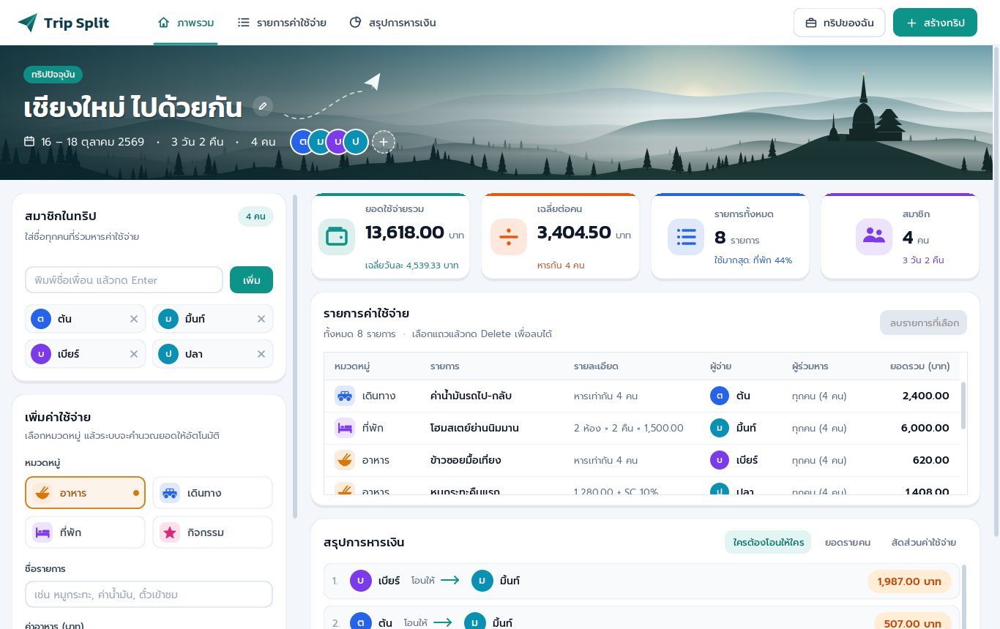
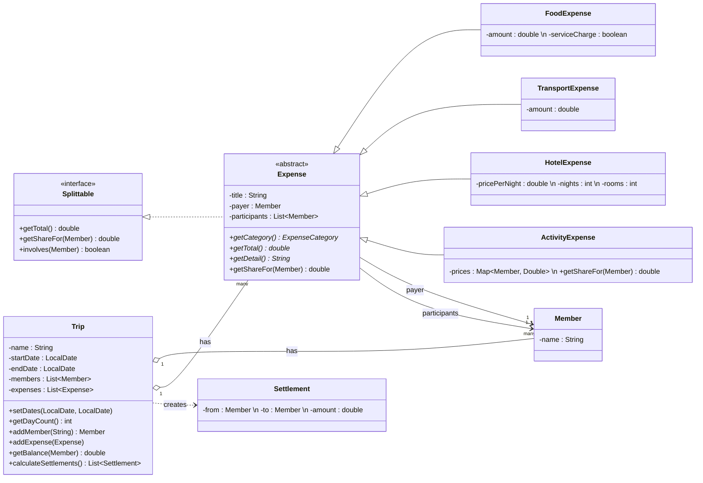
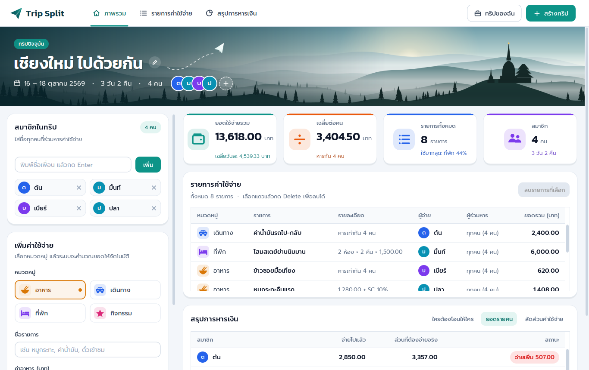
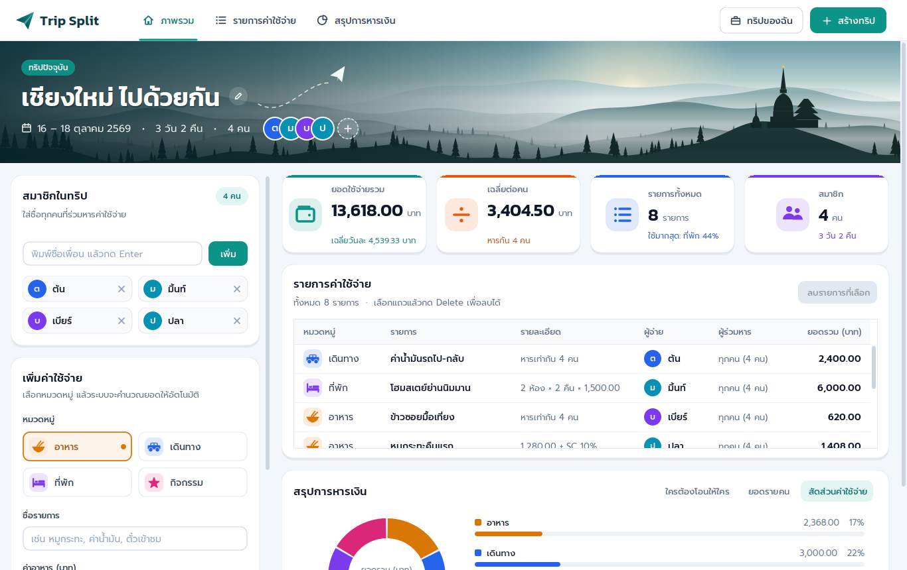
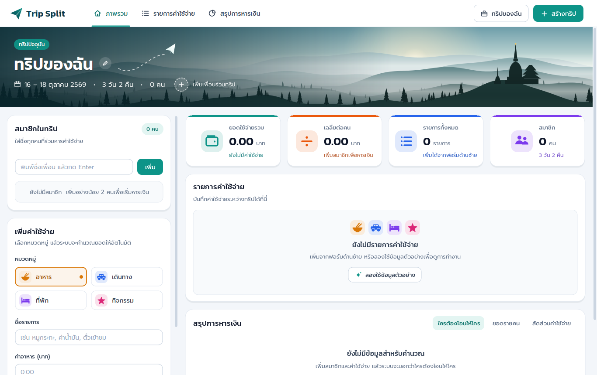

# Trip Split – ระบบจัดทริปเที่ยวและหารค่าใช้จ่าย

โปรแกรม Java Swing สำหรับบันทึกค่าใช้จ่ายระหว่างทริป แล้วคำนวณให้อัตโนมัติว่า **ใครต้องโอนให้ใคร เท่าไร**
ออกแบบตามหลัก OOP ครบ 4 ข้อ และแยกส่วน **Model** (ข้อมูล + Logic) ออกจาก **UI** (หน้าจอ) อย่างชัดเจน



---

## 1. ความสามารถของโปรแกรม

| ส่วน | รายละเอียด |
|---|---|
| แถบเมนู + แบนเนอร์ทริป | แท็บ ภาพรวม / รายการค่าใช้จ่าย / สรุปการหารเงิน, แบนเนอร์วิวภูเขาแสดงชื่อทริป วันที่ จำนวนวัน และรูปสมาชิก |
| สร้าง/แก้ไขทริป | ตั้งชื่อทริป เลือกวันเดินทาง-วันกลับจากปฏิทิน (ปี พ.ศ.) |
| สมาชิกในทริป | เพิ่ม/ลบสมาชิก (ห้ามชื่อซ้ำ, ลบไม่ได้ถ้ามีรายการเกี่ยวข้อง) |
| เพิ่มค่าใช้จ่าย 4 หมวด | อาหาร · เดินทาง · ที่พัก · กิจกรรม – แต่ละหมวดมีช่องกรอกและสูตรคำนวณต่างกัน |
| กิจกรรม: ราคารายคน | มีช่องกรอกราคา 1 ช่องต่อสมาชิก 1 คน พร้อมชื่อกำกับ คนที่ไม่ได้ไป/ไม่ได้จ่ายกรอก 0 + ปุ่ม "ใช้ราคาเดียวกันทุกคน" |
| เลือกผู้จ่าย / ผู้ร่วมหาร | เลือกได้ว่ารายการนี้ใครจ่าย และหารกับใครบ้าง (ไม่จำเป็นต้องทุกคน) |
| ตัวอย่างยอดแบบสด | เห็นยอดรวมและยอดเฉลี่ยต่อคนทันทีขณะกรอก |
| การ์ดสรุป 4 ช่อง | ยอดรวม · เฉลี่ยต่อคน · จำนวนรายการ · จำนวนสมาชิก |
| ใครต้องโอนให้ใคร | คำนวณให้จำนวนครั้งการโอนน้อยที่สุด + ปุ่มคัดลอกสรุปไปวางในแชท |
| ยอดรายคน | จ่ายไปแล้ว / ส่วนที่ต้องจ่ายจริง / สถานะ (ได้คืน, จ่ายเพิ่ม, เคลียร์แล้ว) |
| กราฟสัดส่วน | กราฟโดนัทแยกตามหมวดหมู่ วาดเองด้วย Graphics2D |
| ตรวจสอบข้อมูล | แจ้งเตือนด้วย JOptionPane เมื่อกรอกไม่ครบหรือไม่ถูกต้อง |
| ข้อมูลตัวอย่าง | กดปุ่ม “ข้อมูลตัวอย่าง” เพื่อทดลองใช้งาน/นำเสนอได้ทันที |

---

## 2. วิธีรันโปรแกรม (ต้องมี JDK 17 ขึ้นไป)

**วิธีที่ 1 – ดับเบิลคลิก `TripSplit.jar`** (หรือสั่ง `java -jar TripSplit.jar`)

**วิธีที่ 2 – Windows:** ดับเบิลคลิก `run.bat` (คอมไพล์ + รันให้อัตโนมัติ)

**วิธีที่ 3 – เปิดใน IDE**

| IDE | ขั้นตอน |
|---|---|
| NetBeans | File → New Project → Java with Ant → *Java Project with Existing Sources* → เลือกโฟลเดอร์ `src` → Project Properties ตั้ง Encoding เป็น **UTF-8** → รัน `tripsplit.Main` |
| IntelliJ IDEA | Open โฟลเดอร์ `TripSplit` → คลิกขวา `src` → Mark Directory as → Sources Root → รัน `Main.java` |
| VS Code | ติดตั้ง *Extension Pack for Java* → Open Folder `TripSplit` → เปิด `Main.java` กด Run |

**วิธีที่ 4 – Command line**
```bash
javac -encoding UTF-8 -d out src/tripsplit/*.java src/tripsplit/model/*.java src/tripsplit/ui/*.java src/tripsplit/ui/components/*.java
java -cp out tripsplit.Main            # เริ่มแบบว่าง
java -cp out tripsplit.Main --demo     # เริ่มพร้อมข้อมูลตัวอย่าง
```

> **สำคัญ:** ต้องคอมไพล์ด้วย `-encoding UTF-8` ไม่อย่างนั้นภาษาไทยจะเพี้ยน
> ถ้ารันจาก command line ให้คัดลอกโฟลเดอร์ฟอนต์ไปด้วย: `cp -r src/tripsplit/ui/fonts out/tripsplit/ui/` (NetBeans / IntelliJ คัดลอกให้อัตโนมัติ)

### เปลี่ยนรูปแบนเนอร์เป็นรูปถ่ายของตัวเอง
ภาพวิวภูเขาบนแบนเนอร์วาดด้วยโค้ด (ไม่ต้องใช้ไฟล์รูป) ถ้าอยากใช้รูปถ่ายจริง ให้วางไฟล์ชื่อ `hero.jpg` (แนะนำกว้าง 1600px ขึ้นไป) ไว้ที่ `src/tripsplit/ui/images/` แล้วรันใหม่ โปรแกรมจะใช้รูปนั้นแทนอัตโนมัติ และไล่สีเข้มด้านซ้ายให้ตัวหนังสืออ่านง่ายเหมือนเดิม

### ฟอนต์ที่ใช้ (ฝังมากับโปรแกรม)
| ฟอนต์ | ใช้กับ |
|---|---|
| **Kanit** Medium / SemiBold | หัวข้อการ์ด, ชื่อโปรแกรม, ตัวเลขสรุป |
| **Prompt** Regular / Medium / SemiBold | ข้อความทั่วไป, ป้ายกำกับ, ปุ่ม, จำนวนเงิน |

ฟอนต์อยู่ใน `src/tripsplit/ui/fonts/` (Google Fonts, สัญญาอนุญาต SIL Open Font License – ดู `OFL.txt`) โหลดด้วย `Font.createFont()` ใน `Theme.java` จึงแสดงผลเหมือนกันทุกเครื่องโดยไม่ต้องติดตั้งฟอนต์

---

## 3. โครงสร้างโปรเจกต์ (แยก Model และ UI)

```
TripSplit/
├── src/tripsplit/
│   ├── Main.java                  จุดเริ่มต้นโปรแกรม
│   ├── SampleData.java            ข้อมูลทริปตัวอย่าง
│   │
│   ├── model/                     ── MODEL: ข้อมูล + Logic (ไม่มีโค้ด Swing เลย)
│   │   ├── Splittable.java        interface  สิ่งที่หารเงินได้
│   │   ├── Expense.java           abstract   ค่าใช้จ่าย (คลาสแม่)
│   │   ├── FoodExpense.java       ค่าอาหาร (+Service Charge 10%)
│   │   ├── TransportExpense.java  ค่าเดินทาง
│   │   ├── HotelExpense.java      ค่าที่พัก (ห้อง × คืน × ราคา)
│   │   ├── ActivityExpense.java   ค่ากิจกรรม (ราคาแยกรายคน)
│   │   ├── ExpenseCategory.java   enum หมวดหมู่
│   │   ├── Member.java            สมาชิก
│   │   ├── Settlement.java        ผลการโอน 1 รายการ
│   │   ├── Trip.java              ทริป + การคำนวณทั้งหมด
│   │   └── Money.java             จัดรูปแบบตัวเลขเงิน
│   │
│   └── ui/                        ── UI: หน้าจอ (เรียกใช้ Model อย่างเดียว)
│       ├── TripSplitForm.java     หน้าต่างหลัก (JFrame)
│       ├── TripDialog.java        หน้าต่างสร้าง/แก้ไขทริป
│       ├── ThaiDates.java         จัดรูปแบบวันที่ภาษาไทย ปี พ.ศ.
│       ├── Refreshable.java       interface  ส่วนของหน้าจอที่วาดใหม่ได้
│       ├── TripCard.java          abstract   คลาสแม่ของการ์ดทุกใบ
│       ├── StatsPanel.java        การ์ดตัวเลขสรุป 4 ใบ
│       ├── MemberPanel.java       การ์ดสมาชิก
│       ├── ExpenseFormPanel.java  ฟอร์มเพิ่มค่าใช้จ่าย
│       ├── ExpenseListPanel.java  การ์ดตารางค่าใช้จ่าย + ลบรายการ
│       ├── SummaryPanel.java      การ์ดสรุป 3 แท็บ
│       ├── TripTableModel.java    abstract   คลาสแม่ของตัวเชื่อมตาราง
│       ├── ExpenseTableModel.java / BalanceTableModel.java
│       ├── TableRenderers.java / UI.java / Theme.java
│       ├── fonts/                 ฟอนต์ Kanit + Prompt (.ttf)
│       └── components/            Component ที่ออกแบบเอง
│           ├── TopNavBar.java     แถบเมนูด้านบน
│           ├── HeroBanner.java    แบนเนอร์ทริป (วาดวิวภูเขาด้วยโค้ด)
│           ├── DatePickerField.java  ช่องเลือกวันที่ + ปฏิทิน
│           └── ...                ปุ่ม, การ์ด, ไอคอน, กราฟ ฯลฯ
│
├── test/tripsplit/TripModelTest.java   Test Case ของ Model 22 กรณี
├── docs/screenshots/                   ภาพหน้าจอ
├── TripSplit.jar                       ไฟล์พร้อมรัน
└── run.bat                             สคริปต์รันบน Windows
```

---

## วิธีอ่านคอมเมนต์ในโค้ด

ทุกไฟล์ `.java` มี **กล่องหัวไฟล์** บอกว่าไฟล์นี้คืออะไร และ **เลขส่วน `// # 1.`, `// # 2.` ...** กำกับทุกส่วนของโค้ด

```java
// ############################################################################
// # ไฟล์     : Trip.java
// # ส่วน     : MODEL – ศูนย์กลางของระบบ
// # หน้าที่   : เก็บข้อมูลทริป สมาชิก ค่าใช้จ่าย และ Logic การคำนวณทั้งหมด
// # จุดสำคัญ : Has-many, Encapsulation, Polymorphism
// ############################################################################
...
    // # 19. ★ หัวใจของระบบ: คำนวณว่าใครต้องโอนให้ใคร ให้โอนน้อยครั้งที่สุด (Greedy)
    public List<Settlement> calculateSettlements() {
```

| สัญลักษณ์ | ความหมาย |
|---|---|
| `// # ส่วน : MODEL` | ข้อมูล + การคำนวณ (ไม่มีโค้ดหน้าจอ) |
| `// # ส่วน : UI` | หน้าจอ / Component (เรียกใช้ Model อย่างเดียว) |
| `// # ส่วน : TEST` | Test Case |
| `// # N.` | ส่วนที่ N ของไฟล์ เรียงจากบนลงล่าง |
| `★` | จุดสำคัญที่ควรอธิบายตอนนำเสนอ |

**จุด ★ ที่ควรเปิดให้อาจารย์ดู**
1. `Trip.calculateSettlements()`: คำนวณใครต้องโอนให้ใคร
2. `ExpenseFormPanel.buildExpense()`: UI สร้าง Object คลาสลูกตามหมวด (จุดเชื่อม UI → Model)
3. `TripSplitForm.refreshAll()`: ข้อมูลเปลี่ยนแล้ววาดหน้าจอใหม่ทั้งหมด (วน `refresh()` ของทุกการ์ด = Polymorphism)
4. `StyledTextField.getNumber()`: ตรวจข้อมูลตัวเลข
5. `Theme.font()`: เลือกฟอนต์ที่ฝังในโปรแกรม

---

## 4. Class Diagram



---

## 5. หลัก OOP ที่ใช้ในโปรเจกต์

| หลัก OOP | ใช้ที่ไหน | อธิบาย |
|---|---|---|
| **Encapsulation** | ทุกคลาสใน `model` | field เป็น `private` ทั้งหมด เข้าถึงผ่าน getter, `getMembers()` คืน `unmodifiableList` ภายนอกแก้ list ตรง ๆ ไม่ได้, ตรวจสอบข้อมูลใน constructor |
| **Inheritance** | `FoodExpense`, `TransportExpense`, `HotelExpense`, `ActivityExpense` `extends Expense` | ใช้ field และเมธอดร่วมจากคลาสแม่ (ชื่อ ผู้จ่าย ผู้ร่วมหาร การตรวจข้อมูล) |
| **Polymorphism** | `getTotal()`, `getDetail()`, `getShareFor()` | `Trip.getTotalSpending()` วน `e.getTotal()` เมธอดเดียว แต่แต่ละประเภทคิดคนละสูตร / `ActivityExpense` override `getShareFor()` |
| **Abstraction** | `interface Splittable`, `abstract class Expense` | กำหนดสัญญาว่าค่าใช้จ่ายต้องทำอะไรได้บ้าง โดยไม่สนว่าภายในคำนวณอย่างไร |
| **Has-a** | `Trip` มี `Member` และ `Expense` หลายตัว, `Expense` มี `Member` | ความสัมพันธ์แบบ composition/aggregation |

**OOP ฝั่ง UI (ใช้หลักเดียวกับ Model)**

| หลัก OOP | ใช้ที่ไหน | อธิบาย |
|---|---|---|
| **Abstraction** | `interface Refreshable`, `abstract class TripCard`, `abstract class TripTableModel` | กำหนดว่าทุกส่วนของหน้าจอต้อง `refresh()` ได้ / การ์ดและตารางมีโครงร่วมกัน |
| **Inheritance** | `MemberPanel`, `ExpenseFormPanel`, `ExpenseListPanel`, `SummaryPanel` `extends TripCard` / `ExpenseTableModel`, `BalanceTableModel` `extends TripTableModel` | ได้ field `trip`, หน้าตาการ์ด, หัวคอลัมน์ตาราง จากคลาสแม่ ไม่ต้องเขียนซ้ำ |
| **Polymorphism** | `TripSplitForm.refreshAll()` | วน `view.refresh()` ใน `List<Refreshable>` เมธอดเดียว แต่ละการ์ดวาดตัวเองคนละแบบ |

**สูตรคำนวณของแต่ละประเภท (Polymorphism)**

| คลาส | `getTotal()` | `getShareFor(m)` |
|---|---|---|
| FoodExpense | ค่าอาหาร × 1.10 (ถ้ามี SC) | ยอดรวม ÷ จำนวนผู้ร่วมหาร |
| TransportExpense | จำนวนเงิน | ยอดรวม ÷ จำนวนผู้ร่วมหาร |
| HotelExpense | ราคา/คืน × คืน × ห้อง | ยอดรวม ÷ จำนวนผู้ร่วมหาร |
| ActivityExpense | ผลรวมราคาของทุกคน | ราคาของคนนั้น (override, กรอก 0 = ไม่ต้องจ่าย) |

---

## 6. หลักการคำนวณ “ใครต้องโอนให้ใคร”

1. **ยอดสุทธิ** ของแต่ละคน = เงินที่จ่ายไปแล้ว − ส่วนที่ต้องรับผิดชอบจริง
   - บวก → ต้องได้เงินคืน, ลบ → ต้องจ่ายเพิ่ม
2. แยกคนที่ต้องได้คืน กับคนที่ต้องจ่ายเพิ่ม เรียงจากยอดมากไปน้อย
3. จับคู่ทีละคู่ (Greedy) โอนเท่ากับยอดที่น้อยกว่าของสองฝั่ง จนทุกคนเป็นศูนย์
4. คำนวณเป็นหน่วย **สตางค์ (long)** เพื่อกันปัญหาทศนิยมคลาดเคลื่อน เช่น 100 ÷ 3

ผลลัพธ์: จำนวนครั้งการโอนไม่เกิน (จำนวนสมาชิก − 1) ครั้ง

---

## 7. การตรวจสอบข้อมูล (Validation)

| กรณี | ข้อความแจ้งเตือน |
|---|---|
| ชื่อสมาชิกว่าง / ซ้ำ | กรุณากรอกชื่อสมาชิก / มีชื่อ "..." อยู่ในทริปแล้ว |
| ลบสมาชิกที่มีรายการเกี่ยวข้อง | ไม่สามารถลบ "..." ได้ เพราะมีรายการค่าใช้จ่ายที่เกี่ยวข้อง |
| ยังไม่มีสมาชิกแต่กดบันทึก | กรุณาเพิ่มสมาชิกในทริปก่อน |
| ไม่กรอกชื่อรายการ | กรุณากรอกชื่อรายการค่าใช้จ่าย |
| จำนวนเงินว่าง / ไม่ใช่ตัวเลข / ≤ 0 | กรุณากรอก... / ...ต้องเป็นตัวเลขเท่านั้น / ...ต้องมากกว่า 0 |
| ไม่เลือกผู้ร่วมหาร | กรุณาเลือกผู้ร่วมหารอย่างน้อย 1 คน |
| กิจกรรม: กรอก 0 ทุกคน / ติดลบ | กรุณากรอกราคาอย่างน้อย 1 คน / ราคาของ ... ต้องไม่ติดลบ |

---

## 8. Test Case (Model)

รัน: `java -cp out tripsplit.TripModelTest` (ต้องคอมไพล์โฟลเดอร์ `test` ด้วย)

| รหัส | กรณีทดสอบ | ผลที่คาดหวัง |
|---|---|---|
| TC01 | อาหาร 1,000 + SC 10% | 1,100 |
| TC02 | ที่พัก 2 ห้อง × 2 คืน × 1,200 | 4,800 |
| TC03 | กิจกรรมราคารายคน 200 + 0 + 100 | 300 |
| TC04 | คนที่กรอก 0 ในกิจกรรม | ส่วนแบ่ง 0 |
| TC05 | กิจกรรม: แต่ละคนรับผิดชอบราคาของตัวเอง | A = 200 |
| TC06 | ค่าเดินทาง 900 หาร 3 | 300 / คน |
| TC07 | ยอดรวมทั้งทริป | 7,100 |
| TC08 | ผลรวมยอดสุทธิทุกคน | 0 |
| TC09 | โอนตามผลลัพธ์แล้ว | ทุกคนยอดเป็น 0 |
| TC10 | จำนวนครั้งที่โอน | ≤ สมาชิก − 1 |
| TC11–TC15 | ชื่อซ้ำ, ชื่อว่าง, เงิน 0, ไม่มีผู้ร่วมหาร, ลบสมาชิกที่มีรายการ | แจ้ง Error |
| TC16 | ลบสมาชิกที่ไม่มีรายการ | ลบได้ |
| TC17 | หาร 100 บาท 3 คน | เพื่อนโอนคืนรวม 66.66 |
| TC18 | กิจกรรมกรอก 0 ทุกคน | แจ้ง Error |
| TC19 | กิจกรรมกรอกราคาติดลบ | แจ้ง Error |
| TC20 | ทริป 16–18 ต.ค. | 3 วัน |
| TC21 | ทริป 3 วัน | 2 คืน |
| TC22 | วันกลับก่อนวันเดินทาง | แจ้ง Error |

ผลการทดสอบ: **ผ่าน 22 / 22 กรณี**

---

## 9. ภาพหน้าจอ

| ยอดรายคน | สัดส่วนค่าใช้จ่าย |
|---|---|
|  |  |

| หน้าเริ่มต้น | |
|---|---|
|  | |
